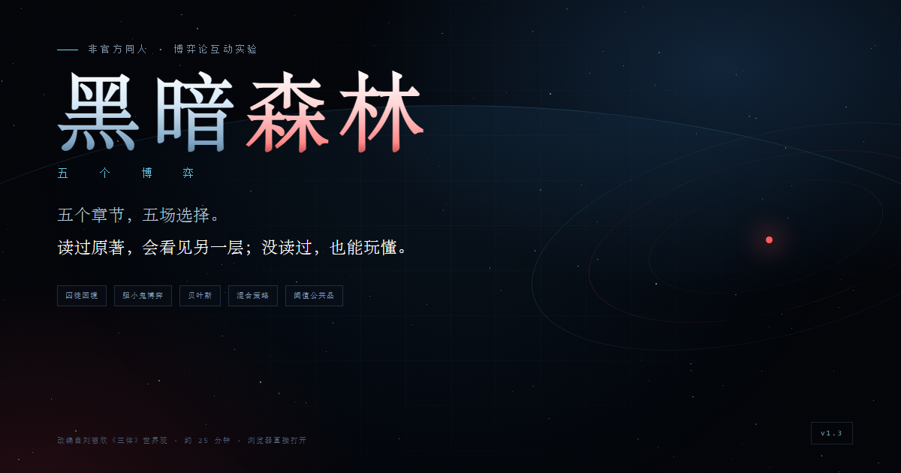

# Games

一些自己做的小游戏。每个游戏一个文件夹，直接放在仓库根目录。

## 游戏

| 游戏 | 入口 | 说明 |
|---|---|---|
| 黑暗森林 · 五个博弈 | [开始游戏](https://youshuo16.github.io/Games/dark-forest/) | 以《三体》为背景的博弈论互动叙事游戏 |

[项目说明](dark-forest/README.md) · [设计文档](dark-forest/设计文档.md)

---

## 关于 AI 生成

本项目的代码、文案、数值设计、程序化图像与音效由 AI 模型（DeepSeek）生成；人类负责提出需求、试玩反馈、审阅与发布决策。项目不代表任何机构或版权方的官方立场。

## 版权与许可

非商业同人作品，基于刘慈欣《三体》世界观改编，与原著作者及版权方无关。每个游戏的 `LICENSE` 与 `NOTICE.md` 都在各自的文件夹内；《黑暗森林 · 五个博弈》的许可见 [LICENSE](dark-forest/LICENSE)、[NOTICE.md](dark-forest/NOTICE.md)。代码与文档以 MIT 发布；《三体》相关设定版权归刘慈欣及相关版权方所有。
