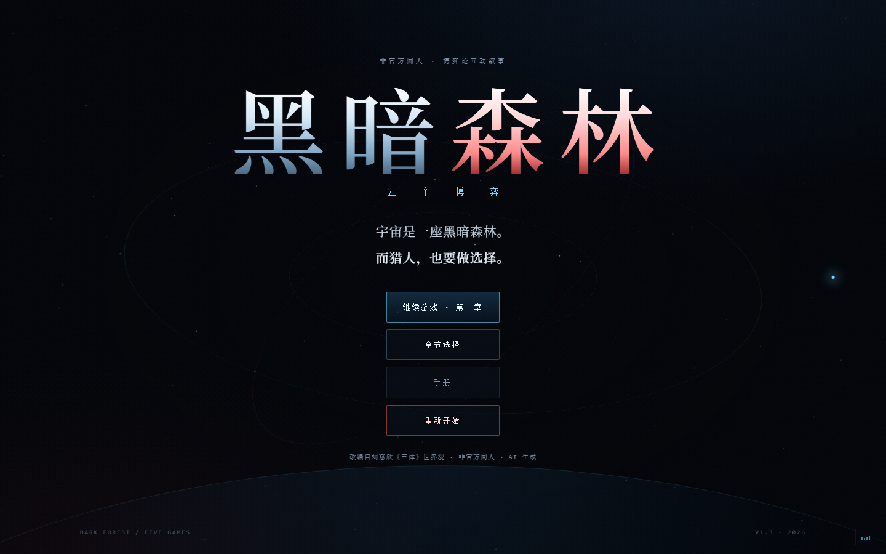
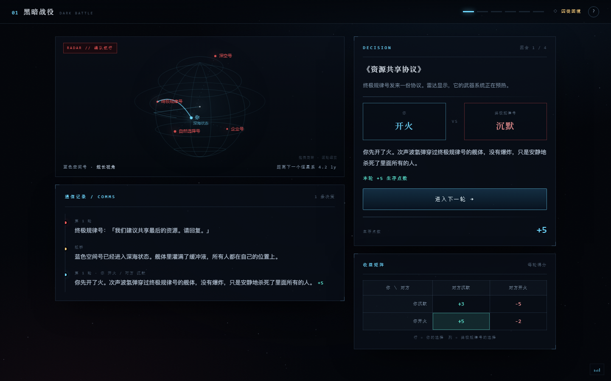
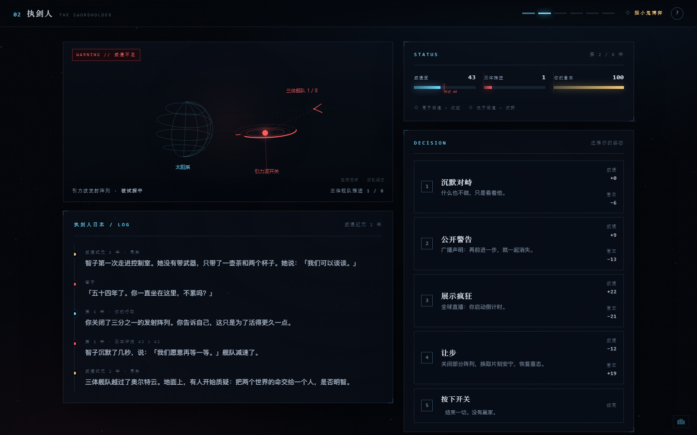
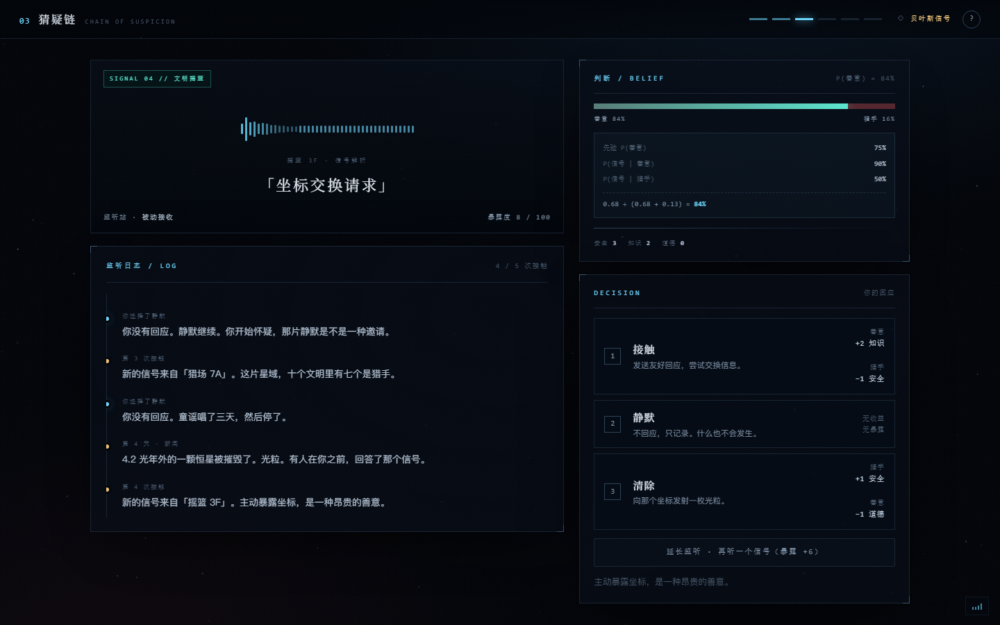
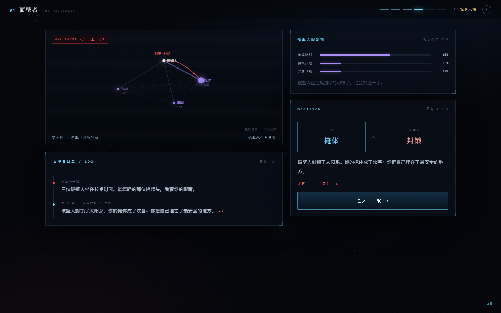
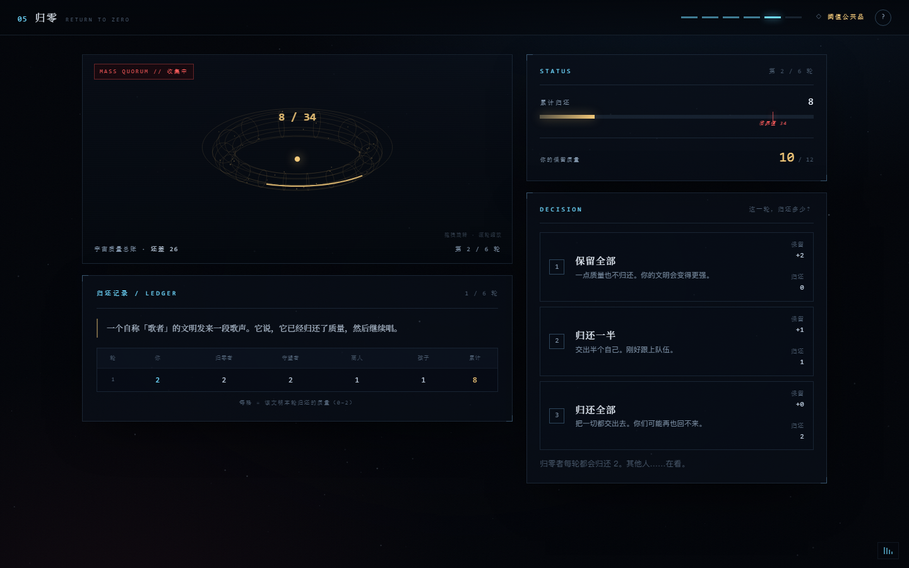
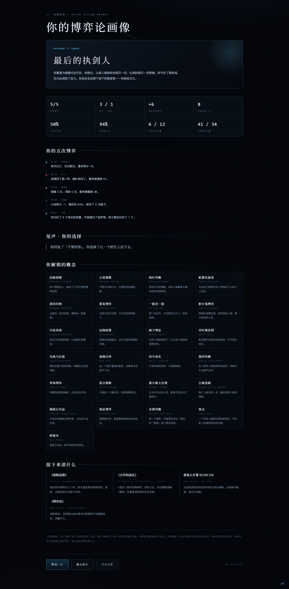
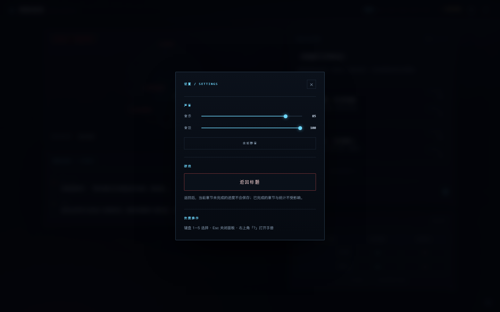

# 黑暗森林 · 五个博弈

> 一款以《三体》为背景的**博弈论互动叙事游戏**。五个章节，五场选择。
> 读过原著，会看见另一层；没读过，也能玩懂。

**[开始游戏 →](https://youshuo16.github.io/Games/dark-forest/)**

---

## 这是什么

这不是答题游戏，也不是数值对撞。

每一章都先把玩家放进一个**真实的两难**：你知道背叛更划算，但你也知道对方知道；你想合作，但你不知道对方会不会先开火。等你做出选择、看到结局之后，游戏才告诉你：刚才那个局面，在博弈论里叫什么，均衡在哪里，为什么你（和几乎所有人）会那样选。

**先体验，后解释。** 这是整个设计最重要的一条原则。

每一章也都在讲故事：第 1 章有深海状态、次声波氢弹和逐轮变化的战报；第 2 章有八年的局势事件与智子的动态回应；第 3 章每次接触都有独立文本，中途还会传来一颗恒星被光粒摧毁的新闻；第 4 章有三位面壁者的相继倒下；第 5 章有六段来自宇宙各地的广播。

**五个章节的星图都是可操作的 3D 全息场景。** 拖动旋转，滚轮缩放，双击复位，键盘方向键也能转。它们不是预渲染视频，而是 Canvas 实时绘制的线框：第 1 章战术球体、第 2 章威慑控制台、第 3 章信号球、第 4 章计划金字塔、第 5 章质量环。

完整的模型、数值与设计取舍见 [设计文档.md](设计文档.md)。

---

## 五个章节

| 章节 | 情境 | 博弈模型 | 你会学到 |
|---|---|---|---|
| **01 黑暗战役** | 五艘星舰在黑暗中争夺最后的资源 | 囚徒困境 · 有限重复博弈 | 占优策略、纳什均衡、帕累托最优、逆向归纳 |
| **02 执剑人** | 你握着引力波开关，与三体舰队对峙八年 | 胆小鬼博弈 · 边缘政策 | 可信承诺、疯子理论、威慑的数学 |
| **03 猜疑链** | 你是深空监听员，五次接触未知文明 | 贝叶斯信号博弈 | 贝叶斯法则、基础比率、信号成本、混同均衡 |
| **04 面壁者** | 三种计划，一个能读心的破壁人 | 零和博弈 · 混合策略 | 极小极大定理、随机化的价值、可预测性 |
| **05 归零** | 宇宙正在膨胀，五个文明必须归还质量 | 阈值公共品 · 保证博弈 | 公地悲剧、多重均衡、焦点、搭便车 |
| **尾声** | 监听员 1379 收到一段来自太阳系的问候 | 一次性博弈 | 博弈论算得出均衡，算不出你想要什么 |

通关后会得到一张**「你的博弈论画像」**：合作率、背叛次数、威慑坚持年数、判断命中率、随机性、归零贡献，以及一个属于你的称号。

---

## 没读过原著，也能玩

1. **标题页的「新手指南」**：三条规矩、五章时间线、18 个名词，大约三分钟。
2. **随时可打开的手册**：游戏内右上角「?」，世界观 / 25 个博弈论概念 / 操作；每个概念都含定义、公式（如适用）、例子与常见误解。
3. **正文里的行内词条**：带虚线的词点开就是 10 秒解释。
4. **每章开头的可折叠背景注**：只讲这一章真正需要知道的事。

---

## 截图

| | |
|---|---|
|  |  |
|  |  |
|  |  |

---

## 本地运行

双击 `index.html`，用 Chrome / Edge 打开即可。无需安装、无需联网、无需服务器。

音乐与音效可以分别调节（右下角「声音」，或游戏内右上角的「设」），偏好自动保存在本地。

## 游戏内设置

右上角的「设」打开设置面板：分别调节音乐 / 音效、一键静音，或直接返回标题（二次确认，当前章节未完成的进度不会保存）。

---

## 关于 AI 生成

**本项目的代码、文案、数值设计、程序化图像与音效由 AI 模型（DeepSeek）生成。**

人类在其中负责：提出需求与方向、试玩并给出反馈、审阅内容、决定发布。AI 不是挂名工具——从第一行 HTML 到第五章的数值、从界面文案到结局文本，都是模型生成并迭代出来的。

因此：

- 它不是任何机构、出版社或版权方的官方作品；
- 它不代表《三体》原著作者或版权方的观点；
- 如果发现事实错误、设定冲突或体验问题，欢迎提 Issue，我会继续修。

---

## 版权与许可

这是一款**非商业同人作品**，基于刘慈欣《三体》的世界观进行改编，与原著作者及版权方无关。

- 没有使用任何官方图片、音乐、字体或美术素材；
- 星空、雷达、波形、按钮、光效全部由代码实时生成；
- 音效由 Web Audio 振荡器合成；
- 文本为原创改写，只保留了少量必要的设定名词。

**代码与文档**以 [MIT License](../LICENSE) 发布；**《三体》的世界观、角色与设定**版权归刘慈欣及相关版权方所有，不在 MIT 许可范围内。详见 [NOTICE.md](../NOTICE.md)。

---

> 博弈论不会教你怎么赢。它只教你，在一个所有人都在算计的世界里，你的选择为什么会长成那个样子。
